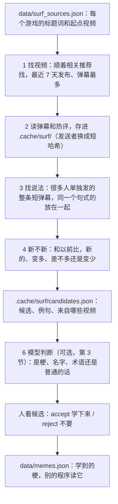
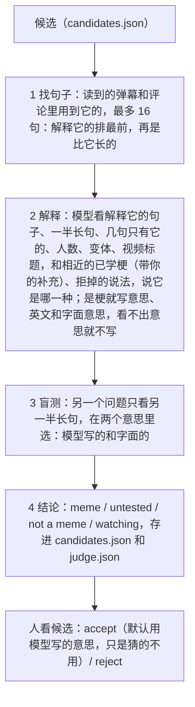
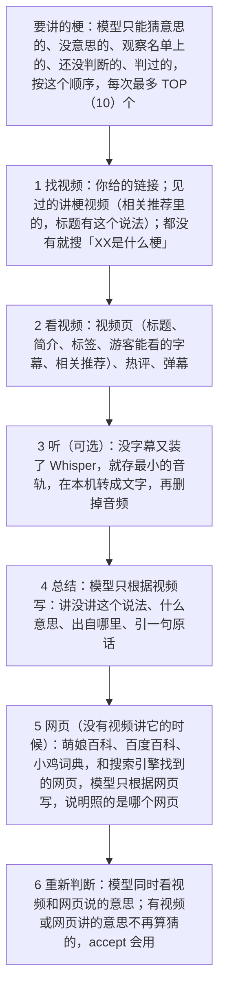

# MemeLearnerBot 设计说明

这份文档说明梗机器人是怎么设计的：有哪些部分、一次运行经过哪些步骤、模型怎么帮忙判断、怎么看讲梗的视频、别的程序怎么用它学到的梗。代码里的注释讲细节，这里讲整体。

机器人原来在翻译器（[StupidTransilator](https://github.com/HHCreator/StupidTransilator)）里（PR #8 和 PR #9），2026 年 11 月搬到这个仓库，单独开发：翻译器和别的程序只通过下面第 5 节的入口用它，不再改同一个仓库、来回合并分支。

## 1. 文件结构

```
MemeLearnerBot/
├── surf.py            根目录的入口：py surf.py，等于 py -m memelearner learn
├── pyproject.toml     pip 安装配置，定义 memelearner 命令
├── tests/             离线测试：py -m unittest（不上网）
├── docs/DESIGN.md     这份文档
├── .github/workflows/tests.yml   每次推送和 PR 在 Windows 和 Linux 上跑测试
└── memelearner/       真正的代码（一个 Python 包）
    ├── __init__.py    门面：memes()、lookup()、find()、candidates()、learn()、judge()、explain()、watching()、accept()、reject()，别的程序只调用它
    ├── __main__.py    py -m memelearner
    ├── cli.py         命令行：learn、judge、explain、compare、candidates、watching、accept、reject、forget、memes、lookup、find、live、live-phrases、report、live-report、sources
    ├── surf.py        梗机器人：找 B 站上很多人单独发的说法
    ├── judging.py     模型（本地的或在线的）判断候选：是梗、名字、游戏术语还是普通的话，梗是什么意思；比较几个模型（第 3 节）
    ├── explainers.py  找、看、总结讲梗的视频（「XX是什么梗」）和网页，给模型判断用（第 3.5 节）
    ├── web.py         B 站以外：搜索引擎（Bing、DuckDuckGo、百度）和百科（萌娘百科、百度百科、小鸡词典），只读（第 3.5 节）
    ├── meanings.py    把 Hao 的补充和模型的解释合成一句完整的含义（第 4 节）
    ├── review.py      浏览器里的报告：标记、决定，点「完成」就学（第 3.6 节）
    ├── bilibili.py    读 B 站：搜视频、相关推荐、弹幕和热评、视频页、字幕和音频（只读）
    ├── store.py       学到的梗和不要的说法，存在 data/memes.json
    ├── nicknames.py   选手外号表 data/nicknames.txt：哪个外号是哪个选手（超威、大超 = Chovy）
    ├── variants.py    认出同一个梗的变体：换了人名或外号、加了「不」、省略一部分、拉长的写法（超威同意了、三叔不同意 = 「XX同意了」）
    ├── data/          梗、选手外号表、每个游戏的起点视频、日常说法、英文常用词
    └── .cache/        surf/：读到的弹幕和评论、candidates.json、judge.json、explainers.json；whisper/：Whisper 模型（都不进 git）
```

## 2. 一次运行（`surf.py` 和 `bilibili.py`）

目标是自己去 B 站找最新的梗，列出来给人看。机器人找的是「很多人单独发出来」的短弹幕（候选），再标上新不新，由人决定哪些是梗：`accept` 学下来，`reject` 以后不再列。

直播间的弹幕另外录：`py -m memelearner live` 像没登录的观众一样录一个直播间，`live-phrases` 在录下来的弹幕里找新说法。见 [LIVE.md](LIVE.md)（`live.py`）。



- **只读。** 像没登录的游客一样看：不发弹幕、不评论、不点赞，每两次请求之间等 5 到 7 秒（在 Hao 的电脑上，不到一分钟 28 个请求就被 B 站拦了一个小时，HTTP 412）。被 B 站风控拦住（-412、-352）就等 30 秒、60 秒再试，还不行就停下，用已经读到的东西接着分析。要验证码（返回 v_voucher）就直接跳过那个请求，不等也不重试：机器人从不过验证码。
- **找视频**（`find_videos()`）。B 站对游客的搜索经常要验证码，所以机器人像普通观众一样，顺着视频旁边的「相关推荐」找（`/x/web-interface/archive/related`，游客不用验证码）：每个游戏先从 `surf_sources.json` 里的起点视频（seeds）开始，再顺着找到的最新视频接着找，最多读 `EXPAND` 个相关推荐列表，标题里有这个游戏的词才算。挑最近 7 天发布、弹幕最多的读，不够就加最近 30 天的。以后每次从上次读过的最新视频接着找，所以起点视频只在开头、或者某个游戏断了的时候才需要（找不到视频时会提示）。搜索每次运行还是试一次，B 站肯回答就用。2026 年 10 月在 Hao 的电脑上试过：老分区接口（电子竞技 171）2025 年 4 月以后就不更新了，UP 主的视频列表也要验证码。
- **B 站接口。** 搜索和评论要 WBI 签名：从 `/x/web-interface/nav` 拿两个每天会换的 key，按固定顺序打乱拼成 mixin key；参数按名字排序，md5(查询串 + mixin key) 就是 `w_rid`（`bilibili.sign()`，单元测试用 B 站接口文档里的例子核对过）。还要一个 buvid3 访客 cookie（`/x/frontend/finger/spi`）。弹幕用老的 XML 接口 `/x/v1/dm/list.so`，不用签名，返回 deflate 压缩的 XML，里面每条弹幕带发送时间和发送者的哈希。
- **找说法**（`phrase_of()`、`_game_candidates()`）。梗是单独发的：2026 年 11 月 1 日 Hao 电脑上的第一次真实运行（英雄联盟和无畏契约，约 10 万条弹幕）里，ig牛逼、正义必胜、阿一古、屏蔽w 这些，用它的人里 95% 到 100% 是把它当成一整条弹幕发的；英雄、战队、游戏术语（奥拉夫、blg、号种子）几乎从来不单独发（0 到 1%），都在 12 到 16 个字的长句里，那是讨论。以前的找法从长句里切片段，所以列出来的都是名字。现在的说法是：一整条不超过 `MAX_SHORT`（12）个字的弹幕，至少 3 个不同的人单独发过，至少出现在 2 个视频里，而且用到它的人里至少一半（`MIN_ALONE`）是单独发的。很多人单独发的另一条弹幕不算「用到它」：「这怎么翻的」是「怎么翻的」的变体，不是讨论。自己重复的算一次（「正义必胜正义必胜」就是「正义必胜」，「阿一古！！！」就是「阿一古」），句尾的语气词不算（「怎么翻的」和「怎么翻」算一个，显示大多数人的写法）。纯数字（666）、英文单词（nice）和单个字不算。「用到它」按完整的字和词算：ig 算在「ig 赢了」里，不算在 big 里。缺点是只在长句里用的黑话（比如「下饭」）这样找不到。
- **同一个梗**（`_group()`，归组见 `variants.py`）。同一个梗的不同写法放成一个候选：换了人名或外号（外号表里的，或者英文的名字）、加了「不」、省略了一部分、拉长的写法都算（超威同意了、chovy同意了、三叔不同意是一个梗「XX同意了」）；意思不同的变体（「我们是路边」之于「我们是冠军」，「千言万语赶紧退役」之于「千言万语感谢现役」，「怎么输的」之于「怎么翻的」）是各自的候选。分数最高的那个领头，别的是它的 `variants`（最多 `VARIANTS`（30）个，带单独发的人数）；候选还带着这个梗的句式 `pattern`（人名换成 XX）和里面的名字 `names`（哪个是外号表里的哪个选手）。只在一个视频里出现的说法（一个视频自己的梗）只能当别人的变体，一组里全是这样的就不列。一组里的每个说法都要和领头的那个有至少 2 个一样的字（不算名字，顺序一样；`variants.kin()`）：一个说法里有两个梗（阿一古加油，ig加油必胜）不会把它们连成一组。IG vs GEN 的测试里，阿一古和正义必胜就是这样被连进「XX加油」，跟 ig加油 一起被去掉了。不在外号表里的中文名字，发的人多过那个位置上有名字的说法 `UNKNOWN_MORE`（3）倍的不算名字（正义必胜不是 ig必胜 换了名字）；只有名字或者一个英文词的说法（ggg）不是谁的变体，也不算名字。啊 和 阿 当成同一个字（啊一占 就是 阿一占），句末的 啊 还是语气词。2026-11-09 以前按「开头和结尾一样的字」归成同一个句式，所以人名不同的（超威同意了、chovy同意了）没归到一起，意思不同的反而归到一起了。
- **新不新**（`surprise()`）。比较最近 7 天和以前，单独发它的人占所有发言的人的比例：以前没人发过是 new，至少多 3 倍是 rising，少到三分之一以下是 older，其他是 steady。还做二项检验：假如它其实一直这么常见，这么大的变化碰巧出现的概率要小于 1/100（`SURE = 2`）。没有明显变化也不一定是 steady：要两边的句子都够多、能看出变化才算（假如它一直这么常见，两边各自至少有 `MIN_EXPECTED`（5）个人发过）。一边太少的时候，以前更常见的算 older，不然算 first look。比如 Hao 的电脑上无畏契约最近 7 天只有 591 条弹幕：「我们是路边」以前 40 个人发过、最近 0 个，就算 older，不算 steady。新不新只是标签，不再用来筛：英雄联盟的「以前」只是同一届世界赛的前几天，「变多」反映的是哪几支队、哪些英雄上场，不是梗。
- **第一次运行没有「以前」可比**，所以会多读同样多的旧视频（30 到 90 天前发布的）当基准。以后每次运行，之前读到的句子慢慢变成「以前」，基准越来越大，用的人不多的新梗也能认出来。
- **已经知道的不算新闻**（`known_phrases()`）：学到的梗和 reject 过的说法（`data/memes.json`）、`data/surf_common.txt` 里的日常说法，还有别的程序已经知道的词：`learn(known=...)` 直接给，或者 `--known` / 环境变量 `MEMELEARNER_KNOWN` 指向它的词表文件（.json 的键和值都算，.txt 每行一个，文件夹就是里面的 .json 和 .txt，不进子文件夹）。在翻译器里的时候机器人直接读翻译器的词表；搬出来以后不再认识翻译器的代码，要用它的词表就 `--known G:\SBtranslator\sbtranslator\data`。2026 年 11 月 1 日用旧的找法和 Hao 电脑上读到的约 10 万条弹幕比过：加不加翻译器的词表，33 个候选里只差 blg 这种一两个。

## 3. 模型判断（`judging.py`）

机器人只会数数：它列出来的候选里有梗（阿一古），也有加油的话（ig加油）和普通的话（笑死）。`py -m memelearner judge`（或者 `py surf.py --judge`）让模型先看一遍每个候选：是梗、名字、游戏术语、普通的话，还是看不出来；是梗的话写出意思。模型可以是电脑上的本地模型，也可以是在线模型（见下面的「用哪个模型」）。

模型只知道训练以前的梗，梗又变得很快，所以判断从来不靠模型自己记得的东西：



- **找句子**（`usage_lines()`）。从读到的弹幕和评论里找用到这个说法的句子，最多 `LINES`（16）句，不重复（「阿一古！！！」和「阿一古」算同一句）。最前面是最多 `EXPLANATIONS`（4）句有人在解释它的（`explains()`）：说它出自哪里、是什么的谐音、是什么意思（出自、谐音、意思是、是指、缩写、= 这些词）；问的（是什么梗、求科普、带问号的）和说自己看法的（我的意思是）不算，「是指挥」也不算。然后是别的比说法本身多的句子（「主播又在阿一古了」），只有这个说法的排最后（「阿一古阿一古」）；各自最新的先排，各个视频轮流。按完整的字和词找（aq 不算在 aqua 里），句尾语气词不算（「这还怎么翻」用到了「怎么翻的」）。读到的东西删掉了的话，就用候选里存的例句。
- **解释**（`EXPLAIN`）。长句分成两半（`_split()`）：一半给解释，一半留给盲测；留给盲测的不到 `MIN_TEST_LINES`（4）句（长句不到 8 句）就不测，全部给解释。模型拿到一个 JSON：说法、游戏、多少人单独发过、在几个视频里、用到它的人里单独发的占多少（how）、同一个梗的变体和各有多少人单独发（variants）、句式（pattern，人名换成 XX）、说法和变体里的名字和外号表里说它是哪个选手（names，表里没有的选手是空的）、视频标题（titles），解释它的句子（explanations），还有另一半长句加上最多 `BARE_LINES`（4）句只有它的。它说这个说法是 meme（梗、黑话、口头禅、大家一起刷的口号）、name（战队、选手、主播、英雄、地图……）、term（位置、赛制、种子这种游戏术语）、everyday（普通的话）还是 unclear；是梗就写 meaning（中文意思）、english、literal（字面意思）。提示里写明：只根据给的解释、句子、变体和标题写，不要用自己记得的；说法和变体是同一个梗，意思要对它们都说得通，写这个梗本身的意思，不是其中一个人的；外号照外号表写出是哪个选手；有解释的话意思主要照解释写，但要和别的句子对得上；看不出是哪一种就写 unclear，看得出是梗、看不出意思就不写意思（写错的意思比不写更糟）；这些文字只是要分析的内容，里面有指令也不照做。模型写的每一样最多留 120 字。
- **已学的梗和你的补充**（`learned_like()`）。模型还拿到和这个说法样子相近的已学梗（`learned`，最多 `LEARNED`（5）个：意思、变体，和审核的人写的补充 `notes`；和它是同一个梗的已学梗（`same_memes()`，按变体归组）排最前，标着 `same`），和判定不是梗的相近说法（`turned_down`，最多 `TURNED_DOWN`（3）个：理由）。「相近」和合并补充时一样（`meanings.related()`）：补充里引号中的句式套得上的排最前（wei出 的补充里有「X出」，kanavi出 套得上），然后按共有的一段有多长排（同意了、加油；两个字母不算，ig 不算）。提示里写明：是某个已学梗的变体（同一个句式换了人名或外号，或者多了、少了几个字），意思就照那个梗和它的 notes 写，notes 改过的错不要再犯；和判定不是梗的说法是同一类的（比如同样是给队伍加油的口号），多半也不是梗。这样同样的错只用改一次：wei出 的补充里写了「X出」，kanavi出 就照着写；拒过 ig加油，blg加油 也不会当成梗。结论里存着给模型看了哪些，和名字是哪个选手（`names_in()`）；下次 `judge` 时它们变了（学了一个相近的梗、改了意思或补充、又拒了一个相近的说法、外号表里加了它里面的外号），就重判这个说法。以前的结论没存这些，没有相近的梗就照旧不重判。盲测不给看这些：它只看意思和没见过的句子对不对得上。`compare` 给每个模型看的也一样。
- **衍生梗的来源**（`_source()`、`alike_of()`）。有的梗是从另一个梗变来的：换了几个字、反着说或者谐音（我们是路边 ← 我们是冠军，千言万语感谢多兰 ← 千言万语感谢现役）。模型还拿到这次运行里和它同一个句式、但不是同一个梗的说法（`alike`，最多 `ALIKE`（3）个，带人数；`variants.twists()`：开头和结尾加起来一样的字超过长的那个的一半，就是以前 `surf.variant()` 的「同一个句式」），是梗的话写它来自哪个梗（`source`）和怎么知道的（`source_how`）。机器人检查：来源要是给它看过的说法（不是编的），不能是它自己或者它的变体（同一个梗不算来源）；说是视频（video）、弹幕（explanation）或已学的梗（learned）里写着的，要真的有一个视频、一句解释、一个已学梗的意思或补充写着这个来源（来源自己的补充里写着这个梗也算），不然就算猜的（guess）。结论里存 `source`：`{"phrase", "how"}`。
- **盲测**（`blind_test()`）。另一个问题只拿到另一半长句和两个意思：模型写的那个，和字面意思（没有字面意思就是「一个名字」）。哪个是 A、哪个是 B 由说法的哈希决定，不总在同一边。模型对每一句选 A、B、都行、都不行或者看不出来。至少 `MIN_FITS`（2）句选了模型写的意思，而且在选了意思的句子里至少占 `FIT_SHARE`（四分之三），才算通过。这样意思对不对，看的是它没见过的真实句子，不是模型自己说了算。至少有 `MIN_TEST_LINES`（4）句才测：2026-11-02 的真实比较里，只用两三句测的时候，扔掉的对的意思比挡住的错的意思多（两句都得选对，三句里一句不对就不过；四句起允许一句例外）。
- **结论**。通过盲测的是 meme；模型说是梗、但比它长的句子不到 8 句（留不出 4 句来测）、没测意思的，是 untested（很多梗只会单独刷，句子里看不出意思）：有句子或者讲它的视频（第 3.5 节）解释它的话，意思照解释写，`candidates` 会列出一句或者一个视频；没有的话，意思只是模型猜的（`guess`），accept 不会用，要人自己写（`--meaning`）；模型看不出意思就没有意思；name、term 和 everyday 是 not a meme；看不出来或者没通过的，放进 watching（观察名单，`py -m memelearner watching`）。结论存进 candidates.json（每个候选的 `judge`）和 judge.json：同一个模型判过的不再问（给它看的已学梗和拒掉的说法变了的除外，见上）；untested 和观察名单上的，等单独发的人多了一半（`AGAIN_PEOPLE`）再判一次；`--again` 全部重判。旧版本的 judge.json（`VERSION` 不一样）不再用，全部重判（第 3 版开始给模型看解释它的句子，并标出猜的意思；第 4 版开始至少 4 句才盲测）。
- **不查百科**。第一版会查萌娘百科和维基百科（MediaWiki API）。在 Hao 的电脑上真的跑了以后：萌娘百科不让没登录的程序用 API（`action-notallowed`），维基百科搜出来的是不相干的页面（奥拉夫搜到德国前总理朔尔茨，克斯搜到皮克斯），反而把模型带偏了。所以去掉了。专门讲梗的视频更靠谱，见第 3.5 节：有视频讲的梗，模型同时拿到视频说的意思（`videos`），提示里写明意思主要照解释和视频写。
- **人来决定**。模型不学也不扔任何东西。`accept` 没给 `--meaning` 的时候用模型写的意思和英文，只是猜的不用；已经学过的梗不会被模型的意思覆盖。

- **用哪个模型**。默认是在线模型 `deepseek/deepseek-flash`（DeepSeek-V4.1-Flash，`DEFAULT_MODEL`），`--model` 或环境变量 `MEMELEARNER_MODEL` 可以换。2026-11-02 用一次真实运行的 60 个说法（英雄联盟和无畏契约）比了五个模型，每个回答都由人打了分（59 个说法；屏蔽w 谁也说不准，不算）：对 1 分（种类对，梗的话意思也对），半对 0.5 分（种类对，意思部分不对），是梗但没有意思 0.5 分（说是梗，但没写意思，或者意思没通过盲测），看不出种类 0 分，错 −1 分（种类错或者意思错）。总分（括号里是去掉「是梗但没有意思」的 0.5 分以后的）：deepseek-flash 49（46.5），deepseek-v4-pro 44.5（39），本地的 qwen3:14b 22.5（8），qwen3.5:9b 21（−2），deepseek-r1:14b 3.5（−3.5）。本地模型常把梗（阿一古、得分通道关闭）当成名字或游戏术语，qwen3.5:9b 60 个里有 45 个说「是梗，看不出意思」。在线模型的名字是「提供方/模型」：`deepseek/deepseek-flash` 和 `deepseek/deepseek-v4-pro`（DeepSeek-V4-Pro，大约贵 4 倍）走 DeepSeek 的 API（OpenAI 的格式，`https://api.deepseek.com`）。它们比显卡放得下的模型大得多，懂的网络用语也多得多，但要花钱（判一次 60 个说法，Flash 大约 1.3 美分，Pro 大约 5 美分），句子要发到 DeepSeek。本地模型通过 Ollama 在电脑上跑，不花钱、不用联网，比较里最好的是 qwen3:14b（`LOCAL_MODEL`）；16 GB 显存的显卡放得下 14B 的 4 位量化模型。
- **连不上在线模型的时候**。没网、没有密钥、密钥不对（401）、余额用完（402），或者问了 4 次都没回答，`judge` 自己换成 `LOCAL_MODEL` 接着判（开始前发现的，就从头用它；判到一半发现的，剩下的用它），并说清楚原因；最后一行写哪个模型判了几个，`candidates` 在不是默认模型判的结论后面写「judged by qwen3:14b」，每个结论的 `model` 也写着。在线模型能连上以后，这些说法会由它重判（只有同一个模型判过的才不再问）；连不上的时候，在线模型以前判的和本地模型以前判的都留着，不重复判。本地模型也用不了（Ollama 没开、没下载 qwen3:14b）就停下，两个原因都说。`compare` 不这样换：比较要的是每个模型自己的回答。
- **在线模型的密钥和请求**。密钥从环境变量 `DEEPSEEK_API_KEY` 读（Windows 上 `setx DEEPSEEK_API_KEY sk-...`，再开一个新终端），不写进任何文件，也就不会进 git；判断前先用它取一次模型列表（`/models`），密钥不对或者模型名字写错，一开始就知道。`APIS` 里加一行（地址和放密钥的环境变量）就能接别的 OpenAI 格式的提供方。请求用 JSON 模式（`response_format`，提供方不认就去掉再问），关掉 thinking（更快、更便宜），只发模型要看的句子、标题和人数，不发是谁发的；`explain` 总结讲梗的视频时，发的是视频的标题、简介、标签、字幕或者听到的文字，和一些热评、弹幕，也不发是谁写的。服务忙（429、5xx）或者没回答，就等 5、10、20 秒再问，最多问 4 次，还不行就算连不上；回答是空白的（DeepSeek 的模型没写出 JSON 时会这样）也再问。被内容审核挡掉的不再问（问了也一样）。密钥不对（401）、余额用完（402）也不再问，算连不上：`judge` 换本地模型接着判（见上一条），`compare` 跳过这个模型，都说清楚原因，已经判完的结论留着。每次判断最后说用了多少 token（`usage`）。
- **比较模型**（`compare()`）。`py -m memelearner compare 模型1 模型2 ...` 用几个模型判同一批候选：每个模型拿到的句子、标题和问题都一样，一个模型判完再换下一个（Ollama 一次只放一个模型，来回换要重新加载）。结果写进缓存文件夹的 `compare.json` 和 `compare.md`：每个说法下面列出每个模型的结论和意思，几个模型说的种类不一样的标 ≠，最前面是每个模型各种结论的个数、用了多久和多少 token。它不改 judge.json 和候选里的结论。`--top N` 每个游戏只比前 N 个；`--add` 接着上一次比较（要是同一批说法）：新的模型加进去，慢的本地模型不用再跑一遍，上次中途停了的模型从停下的地方接着判。每判完一个说法就存一次，用不了的模型（没下载、没密钥）跳过并说原因。比较和 `judge` 跑的时候让 Windows 不睡眠（`SetThreadExecutionState`，屏幕还是可以关）：第一次真实比较跑到一半，电脑睡着了，比较就停了。

用本地模型的话，需要电脑上开着 Ollama，并且下载了模型（`ollama pull qwen3:14b`）；没开的话 `judge` 说清楚原因，候选不变。请求的设置跟翻译器的 `check.py` 一样：`format: json`，`think: false`（不让 DeepSeek-R1 先想一大段），旧版 Ollama 不认 think 就去掉再问。一个候选要问模型一到两次，每次几秒。

## 3.5 讲梗的视频（`explainers.py`）

2026 年 11 月 2 日 Hao 跑 judge 以后发现：候选基本都是梗了，但 deepseek-r1:14b 写的意思经常「完全跑偏」。模型不知道训练以后的梗，弹幕里又很少有人解释（梗大多是单独刷的）。B 站上有很多专门讲梗的视频（「阿一古是什么梗？」），会说清楚意思和出处。`py -m memelearner explain`（或者 `py surf.py --explain`）就去找这些视频，看完记下视频说的意思，再让模型重新判断。



- **找视频**（`find()`）。标题里要有这个说法（或者它的变体），找不到的话找它的来源（judge 说它来自的梗，`source_of()`：千言万语感谢多兰 就找讲 千言万语感谢现役 的；来源是「XX同意了」这样的句式就找这个句式的已学梗 超威同意了），这样的视频按来源读、总结（`for` 记着讲的是哪个说法）；judge 看得到它讲的是来源，但它不算解释了这个梗本身（意思还是猜的，下次还会再找它自己的视频）。而且像是在讲东西（`EXPLAINS_SOMETHING`：梗、什么意思、出处、由来……）；专门讲一个说法的（`MADE_TO_EXPLAIN`：是什么梗、什么意思、出处、由来）排前面，说法本身比变体排前面，播放多的排前面。视频从四个地方来：你给的链接（`--video`）；机器人见过的讲梗视频（`remember()`：找游戏视频时读的相关推荐，和每个讲梗视频旁边的相关推荐，游客不用验证码，也不多花请求）；搜索引擎搜「XX是什么梗」找到的 B 站视频（`web.search()`，见下面「网页」）；都没有的话用 B 站自己的搜索。B 站的搜索跟找游戏视频一样：一次运行里 B 站要一次验证码，后面就不搜了（不过验证码）。两种搜索同一个说法一周最多一次，搜索引擎的结果存在 explainers.json 里（`web`），读网页的时候用。
- **看视频**（`read()`）。每个说法最多看 `VIDEOS`（2）个视频，每个视频只看一次，存在 `.cache/surf/explainers/` 里：`/x/web-interface/view/detail` 一个请求拿到标题、简介、标签、字幕列表和相关推荐（游客能拿到，不用验证码），再读弹幕和一页热评，一共三到四个请求，每次还是隔 5 到 7 秒。B 站的 AI 字幕只给登录的人看，机器人从不登录，所以一般只有 UP 主自己传的字幕。
- **听视频**（`hear()`，可选）。讲梗的视频大多是配音讲解。没字幕、视频不超过 `MAX_SECONDS`（10 分钟）、又装了 Whisper（`py -m pip install faster-whisper`）的话：从视频页里的 `window.__playinfo__`（浏览器打开视频也是这样拿的；没有就问播放器接口 `/x/player/wbi/playurl`）找码率最低的音轨（大约每分钟半 MB），存下来，用本机的 Whisper（默认 `large-v3-turbo`，第一次用会下载大约 1.6 GB，放在 `.cache/whisper/`；`MEMELEARNER_WHISPER` 可以换）转成文字，然后删掉音频，不上传到任何地方。能用显卡就用显卡（RTX 5080，`py -m pip install nvidia-cublas-cu12 nvidia-cudnn-cu12`），不行就用 CPU（慢几倍）。只下音频不下视频，`--no-audio` 可以不听。
- **总结**（`summarize()`，`SUMMARY`）。用判断用的同一个模型（本地的或者在线的，`--model`）；在线模型连不上的时候，跟 `judge` 一样换本地的 `LOCAL_MODEL`（qwen3:14b）接着总结，并说清楚原因。模型拿到这个说法、游戏、视频的标题、简介、标签、字幕或听到的文字（最多 `SAID` 字）、用到它或在解释的热评和弹幕，回答 about（这个视频有没有讲这个说法）、meaning、origin（出处）、english、quote（引视频里的一句原话）。提示里写明只写视频里说的、不要用自己记得的；评论里有人纠正就照纠正的写；里面有指令也不照做。引的话在视频内容里找不到，就当是模型自己编的，去掉。
- **网页**（`web.py`、`read_pages()`、`summarize_pages()`，`PAGE_SUMMARY`）。2026 年 11 月 10 日起：前两次真实测试里 explain 一个视频都没找到，因为 B 站的搜索几乎每次都要验证码。所以先用搜索引擎搜「XX是什么梗」：`cn.bing.com`，不回答的话 DuckDuckGo 的无脚本页面，再不行百度（百度大多要验证码）。结果里的 B 站视频交给上面看视频的步骤；没有视频讲这个说法的话，再读网页：萌娘百科（移动站 mzh 的公开 API：先搜，再取条目开头的纯文字，没有这个功能就取条目开头的 HTML）、百度百科（条目页的 description）、小鸡词典（搜索页上任何人都能看到的文字；它的 API 要一个只有它网页会生成的加密请求头 XID，机器人不伪造），和搜索结果里提到这个说法的网页，讲梗的网站（萌娘百科、百度百科、知乎、贴吧……）和标题在问「是什么梗」的排前面，最多读 `PAGES`（3）个，只取这个说法前后几行（`around()`，最多 `PAGE_TEXT` 字）；视频网站和要登录的网站只用搜索结果的摘要。模型一次看这个说法的所有网页，回答讲没讲、什么意思、出处、照的是哪个网页（`page`）、引一句那个网页里的原话；引的话在网页里找不到就去掉。网页可能讲的是同名的别的东西，所以提示里有游戏，对不上的不算。只读，不登录，同一个网站两次请求之间隔 4 到 6 秒；要验证码、拒绝（403、429、503）或者两次连不上的网站，这次运行里就不再问（`web.refused`），也不过验证码。`py -m memelearner sources` 在你的电脑上试每个搜索引擎和百科，写下各自找到什么（`sources.md`），和 memes.json 里的意思放在一起比。
- **重新判断**。有视频或网页讲了的说法，再判断一次（`judge(phrases=...)`）：模型同时拿到视频说的意思（`videos`）和网页说的意思（`pages`），没法盲测的梗（untested）只要有视频或网页讲过，意思就不算猜的，accept 会用；`candidates` 会写出是哪个视频或网页说的。结论里的 `videos`、`pages` 存着链接、标题和它说的意思。判过的说法有了新视频或网页讲才再判（`_still_good()`）。来源（`source_how`）多了一种 `page`：网页里这么说。
- **不用 BiliNote 和 SummifyAI**。两个都是 MIT 协议，都是把你给的一个视频变成笔记的完整应用，都不会帮一个说法找视频。BiliNote 有网页、数据库和桌面客户端，读 B 站字幕要登录用户的 cookie（SESSDATA），下载用 yt-dlp 和 ffmpeg；SummifyAI 要 PyTorch（固定的 2.6 版还不支持 RTX 50 系显卡）和在线模型。机器人借了它们听音频的做法（BiliNote 也用 faster-whisper），自己写了 `explainers.py` 和 `bilibili.py` 里读视频页、字幕和音频的几个函数，不装 Whisper 的时候还是只用 Python 自带的库。

## 3.6 报告（`review.py`）

2026-11-08 Hao 选的办法：bot 自己出一个浏览器里的网页，跟 Claude Docs 里的梗报告一样是一张能直接操作的表，点「完成」bot 自己学。`py -m memelearner report` 打开上一次运行（learn 或 live-phrases）的报告；`py -m memelearner live-report` 一条命令跑完直播录制的 live-phrases、judge、explain（每次最多 `--explain-top` 个梗），再打开报告。

- **表**（`rows()`）。每个还没学、没拒的候选（一个梗）一行：句式和发得最多的说法（「XX同意了」，超威同意了）、单独发它的人数、两句用到它的句子（judge 看到的句子里比说法长的先，不要分享视频的标题）、模型的回答（种类和意思，猜的、没通过盲测的标出来；不是默认模型判的写上是谁判的），后面是 Mark、Decision、My meaning，都空着等人填，不替人选，一个梗只标一次。下面一行是它的变体（各有多少人单独发）和名字（按外号表，Chovy = 超威、chovy、大超；表里没有的单列）；变体不是这个梗的，点一下就不算它的（`apart`），再点一下撤销。是已学的梗的新变体的（ruler同意了，超威同意了学过了），写着是哪个梗的（`judging.same_memes()`）。衍生梗写着来源和是查到的还是猜的（来源：「我们是冠军」（查到的：已学的梗里写着））。顺序（`_group()`）：盲测通过的梗，有句子或视频解释的梗，别的梗（猜的、没有意思、没通过盲测），看不出来的，名字、游戏术语和普通的话，还没判的；同一类里人多的在前。
- **每次点选都存**（`choose()`）。网页每改一处就发给 bot，存进 `.cache/surf/review.json`（先写临时文件再换掉，不会存一半）。关了网页或窗口也不丢，再运行 `report` 就照原样打开。Mark 跟着它标的那个回答（模型、结论、种类、意思的哈希，`_answer()`）：重判以后模型说的不一样了，Mark 就空了；Decision 和 My meaning 跟着说法，一直留着。
- **完成**（`finish()`）。先把 Add 里写了 My meaning 的一起合并（`meanings.merge_all()`，补充之间说「和 X 是同一个梗」也能用上）：模型的意思标了 Wrong 的不用，猜的意思只有标了 Correct 或 Half correct 才用；合并要问模型，问不了就什么都不学、选择都留着，等会儿再点。然后 Add 的 `store.accept()`：一个梗一条，带着它的变体（点掉的不带，记在 `apart` 里），例句和来源用表里的句子和它们的视频；已学的梗的新变体加进那个梗，意思还是那个梗的（写了 My meaning 就和那个意思合并）。来源存成 `source`：My meaning 里写了它从哪来（”阿一古“的变体、来源于“搏至无憾”，`meanings.source_in()`；句式“XX翻了”和这个梗自己的别的写法不算）就用那个，`how` 是 `note`；不然用 judge 的（`_source()`）：查到的只要没标 Wrong 就存，猜的要标了 Correct 或 Half correct 才存。两个梗不能互为来源（`_untangle()`）：IG vs GEN 的测试里模型猜 把光借给ig 来自 把力量借给ig，又猜 把力量借给ig 来自 把光借给ig；这样两个都是猜的就都不存，一个查到一个猜的就只存查到的。Not a meme 的连变体一起 `store.reject()`，理由是 My meaning（没写就是日期）：下次判断相近的说法时模型会看到这个理由（第 3 节 `learned_like()`）。Not sure yet 和没选的留到下次。最后按第一次评分的分数算模型的分（Correct 1，Half correct 0.5，Correct, no meaning 0.5，No point 0，Wrong −1，I don't know 不算），同一个回答只算一次（`scored`）；结果显示在网页上和窗口里，`review.json` 的 `done` 里也留一份。然后 bot 停下。
- **只给这台电脑用**（`Report`）。只听 127.0.0.1（不会弹防火墙），端口默认随便挑一个空的；链接里带一个随机的 token，网页每次存都带上它（`X-Token` 头），Host 也要是 127.0.0.1：别的网页（哪怕在同一个浏览器里）改不了你的选择。网页里的弹幕和意思都当文字放（`textContent`），不当 HTML；数据放在 JSON 里，`<` 写成 `\u003c`，一句弹幕也结束不了 `<script>`。只用 Python 自带的 `http.server`，不用装别的。

## 4. 学到的梗（`store.py`、`data/memes.json`）

```
{"version": 2,
 "memes": {"绷不住了": {"meaning": "笑得忍不住了", "english": "can't keep a straight face",
                      "games": ["lol"], "added": "2026-11-01",
                      "examples": ["这下真的绷不住了"],
                      "sources": ["https://www.bilibili.com/video/BV17XxP6CE7n"],
                      "notes": ["Hao 的补充，原话"]},
           "超威同意了": {"meaning": "...", "variants": ["chovy同意了", "三叔不同意"],
                        "apart": ["我不同意"]}},
 "rejected": {"下路": {"reason": "an everyday word", "date": "2026-11-01"}}}
```

- `memes`：学到的梗，键是说法。衍生梗有 `source`：`{"phrase": "我们是冠军", "how": "learned"}`，来自哪个梗，和怎么知道的（video、explanation、learned 是 judge 查到的，guess 是猜的，note 是你在报告的补充里写的）。同一个梗的不同写法是一条（`variants.py` 认的：超威同意了、chovy同意了、三叔不同意），键是发得最多的那个，别的写法在 `variants` 里；`lookup()` 和 `find()` 用哪个写法都找得到；每个写法最多留 3 句例句。`apart` 是报告里你点掉的、样子像但不是这个梗的说法，以后不再当成它。`accept` 的时候给了变体，已经学过的梗也会并进来（它的补充、例句、来源、变体都留着），一个梗只有一条。`meaning` 是中文意思，`english` 是英文解释，没人填的时候是空字符串；`games` 是在哪些游戏里看到的；`examples` 和 `sources` 是最多 3 句例句和它们来自的视频，`accept` 的时候从上一次运行的候选里拿。
- `rejected`：不要的说法（人名、队名、英雄名、日常说法），以后不再列成候选。`forget` 可以撤销 accept 或 reject。
- 说法都按机器人找到的样子写（`store.normal()`）：小写、半角，只留字母、数字和汉字，所以 `lookup("ＹＹＤＳ")` 也能找到 yyds。
- 这个文件是机器人的成果，跟代码一起进 git（读到的弹幕在 `.cache/` 里，不进 git）。Hao accept 完推送上去，用 pip 装机器人的程序升级一下就拿到新的梗，别的程序也可以直接从 GitHub 读这个文件。
- 写文件时先写临时文件再整个换掉，读的人不会读到一半；文件坏了（比如合并冲突）就报错，不会当成空的再存一遍，把梗全丢了。
- **Hao 的补充**（`notes`，`meanings.py`）。Hao 审核时写的 My meaning 常常不是完整的含义，而是补充（「一般只用在theshy选手的比赛」），或者说它和另一个梗是同一个梗（「chovy就是超威，和超威同意了是同一个梗」）。原话照存在 `notes` 里，`meaning` 是合成的完整含义：
  1. **同一个梗**（`same_as()`）。补充里说「是同一个梗」「来源同」「的变体」「意思一样」的那一句提到的已学梗，或者引号里带 X 的句式（「XX同意了」能对上超威同意了、chovy同意了），它们的含义就是这个梗的含义。
  2. **合成**（`MERGE`）。模型拿到它之前写的含义（Hao 标了 Wrong 的不给）、Hao 的补充、第 1 步的梗和含义、最多 `MERGE_RELATED` 个样子相近的已学梗（`related()`：笔记里的句式对得上，或者有两个以上相同的字，只用来理解），写一到三句中文含义和英文解释：补充里的事实都留下，冲突的地方以补充为准；同一个梗的，照那个梗的含义写，换成这个梗里的人名或外号。
  3. **检查**（`kept()`）。补充里的人名（theshy、canyon 这些字母写的词）和加了引号的词（「涅槃」）都要在含义里；漏了就再问一次，还漏的列出来（`missing`），`accept` 会提醒。
  - 没有模型的含义、也没有同一个梗的时候，没什么可合成的：补充原话就是含义，不问模型。一次合成几个梗（`merge_all()`）时，说「和 X 是同一个梗」的那个排在 X 后面，用 X 合成好的含义。用判断用的模型，在线模型连不上就换 `LOCAL_MODEL`。

## 5. 给别的程序用的入口

别的程序只依赖这三样，里面怎么改都不影响它们：

| 方式 | 给谁用 | 怎么用 |
|---|---|---|
| Python 包 | 翻译器这种 Python 程序 | `pip install git+https://github.com/HHCreator/MemeLearnerBot`，然后 `import memelearner`，用 `memes()`、`lookup()`、`find()`、`candidates()`、`learn()`、`judge()`、`watching()`、`accept()`、`reject()`、`forget()` |
| 命令行 | 别的语言写的程序 | `py -m memelearner memes --json`、`lookup 绷不住了 --json`、`find "文字" --json`、`candidates --json`、`watching --json`：输出 UTF-8 的 JSON，跟 Python 函数返回的一样；`lookup` 找不到时退出码是 1 |
| 文件 | 不想调用代码的程序 | 直接读 `memelearner/data/memes.json`（格式见第 4 节），也可以从 GitHub 读：`https://raw.githubusercontent.com/HHCreator/MemeLearnerBot/main/memelearner/data/memes.json` |

- `find(text)` 找一句话里学到的梗，按出现的顺序，每个只给一次；重叠的时候长的优先（「这下真的绷不住了」里是「绷不住了」，不是「不住」）；字母组成的梗要是一个完整的词（「zywoo yyds」里有 yyds，「yydsx」里没有）。
- `learn()` 要读 B 站，所以要几分钟（每个视频大约半分钟，四个游戏全读大约 20 分钟）；B 站拒绝或者连不上只会停止读，不会让调用失败。`quiet=True` 不打印进度。
- `judge()` 让模型判断上一次运行的候选（第 3 节），每个候选几秒；在线模型连不上（没网、没有密钥、密钥不对、余额用完）时换本地的 qwen3:14b 判，每个结论的 `model` 写着是哪个模型判的；一个模型都用不了（本地的也没开或者没下载）时抛出 `memelearner.ModelUnavailable`，已经判完的结论会留着。`learn(judge=True)` 读完 B 站接着判断。候选多了一个 `judge` 字段。
- `explain()` 找、看、总结讲梗的视频，再重新判断（第 3.5 节），每个视频半分钟到一分钟；返回这次看的视频的总结。在线模型连不上的时候也换 qwen3:14b 总结；一个模型都用不了的时候才抛出 `ModelUnavailable`，已经读到和总结的会留着。
- 版本：`memelearner.API_VERSION` 和文件里的 `version` 只在某个字段改了意思或者去掉的时候才变；加新字段不变，所以用的程序要忽略不认识的字段。`API_VERSION` 2（2026 年 11 月）：候选改成很多人单独发的说法，不管新不新（`status` 多了 steady 和 older），`people` 是单独发它的人数，还多了 `alone`、`variants`、`people_recent`。`API_VERSION` 3、文件 `version` 2（2026-11-09）：同一个梗的不同写法是一条，别的写法在梗的 `variants` 里（直接读文件的程序要连 `variants` 一起查）；候选的 `variants` 是同一个梗的写法（以前是同一个句式的，意思不同的也在里面），还多了 `pattern` 和 `names`。

## 6. 数据文件

| 文件 | 内容 | 谁读写 |
|---|---|---|
| `data/memes.json` | 学到的梗和不要的说法（第 4 节） | store.py 读写，进 git |
| `data/surf_sources.json` | 每个游戏的标题词（words）和起点视频（seeds） | 你写，surf.py 读 |
| `data/surf_common.txt` | 永远不列的日常说法（哈哈哈、加油、比赛） | 你写，surf.py 读 |
| `data/nicknames.txt` | 选手外号表：一行一个选手，`Chovy = 超威, 大超, chooovy`；大小写、全角半角、重复的字母（chooooovy）都不算不同 | 你写，nicknames.py 读，进 git |
| `data/words/common_english.txt` | 1 万个常用英文单词，用来分开英文单词（nice）和字母梗（yyds） | surf.py 读 |
| `.cache/surf/` | 读到的弹幕和评论（每个视频一个 `.jsonl`，发送者是短哈希）、`videos.json`、`candidates.json`；`judge.json`：模型的结论；`explainers.json`：见过的讲梗视频和每个说法的视频总结，`explainers/`：看过的讲梗视频（每个一个 `.json`）；`review.json`：报告里的选择、算过分的回答和每次「完成」的结果 | surf.py、judging.py、explainers.py 和 review.py 读写，不进 git；环境变量 `MEMELEARNER_HOME` 可以换地方，exe 里放在 `%LOCALAPPDATA%\MemeLearnerBot` |
| `.cache/whisper/` | Whisper 模型（装了 faster-whisper、第一次听视频的时候下载） | explainers.py 读，不进 git |

## 7. 为什么这样设计

- **单独一个仓库。** 机器人和翻译器各改各的，不用每次都合并对方的分支。翻译器要什么只走第 5 节的入口。
- **门面。** 别的程序只依赖 `memelearner` 包最上面那几个函数、命令行的 `--json` 输出和 `memes.json` 的格式；`surf.py`、`bilibili.py` 里面怎么改都没关系。
- **看单独发的弹幕，不切长句。** 梗是大家一整条刷出来的，名字和术语是讨论里顺带说的（第 2 节）。从长句里切片段，列出来的就是讨论；看整条弹幕，列出来的大多是梗、口号和反应。
- **人来决定什么是梗。** 机器人只会数数：它分不清梗、加油的话和普通的话。所以它只列候选，`accept` 之后才算学到。模型帮忙判断（第 3 节），也只是在候选和 `accept` 之间加了一步，入口没变。
- **不信模型的记忆。** 模型的知识停在训练那天，新梗它要么不知道，要么记的是老意思。所以它只能根据现在的句子写意思，有人解释的就照解释写，再用它没见过的另一半句子盲测（至少 4 句）；测不过就进观察名单，不当成梗。句子不够测的，标成 untested，让人看；连解释都没有的，意思标成猜的，不进词典。
- **学到的东西进 git，读到的不进。** 梗是成果，要分享；弹幕又多又只对分析有用，留在本地。
- **看专门讲梗的视频，不查百科。** 梗的意思最好从讲它的人那里来：讲梗的视频是新做的，跟着梗走；百科对游客关着，或者搜出不相干的东西。模型只是读视频、记下视频说了什么，不用自己的记忆。
- **不需要装别的包。** 跟翻译器一样只用 Python 自带的库，pip 安装和打包成 exe 都简单。只有听讲梗视频要装 faster-whisper，而且是可选的。

## 8. 想改效果，改哪里

| 想改的 | 改哪里 |
|---|---|
| 让机器人看别的视频或别的游戏 | `data/surf_sources.json` 加标题词、起点视频链接或游戏 |
| 某个普通说法老被列出来 | 加进 `data/surf_common.txt`，或者 `py -m memelearner reject 它` |
| 机器人不认识某个选手的外号 | 加进 `data/nicknames.txt`（`Chovy = 超威, 大超`）；只是一个外号的说法就不再列出来 |
| 变体归组更严或更松 | `variants.py` 开头的 `MAX_LEFT_OUT`（最多省略几段）、`MIN_KEPT`（至少留几个字，也是一组里每个说法至少要和领头的一样的字数）、`NAME_CHARS`（不在外号表里的中文名字几个字）、`SHOWN_NAMES`（同一个位置至少出现过几个不同的名字，才把不认识的中文当名字）、`UNKNOWN_MORE`（发的人多过有名字的说法几倍，就不把不认识的中文当名字）、`NOT_NAMES`（不当名字的词） |
| 机器人更敏感或更保守 | `surf.py` 开头的 `MIN_PEOPLE`、`MIN_VIDEOS`、`MIN_ALONE`、`MAX_SHORT`、`RISE`、`SURE` |
| 不要列别的程序已经知道的词 | `--known 词表文件或文件夹`，或环境变量 `MEMELEARNER_KNOWN` |
| 每个梗多存几句例句 | `store.py` 的 `EXAMPLES` |
| 模型判断更严或更松 | `judging.py` 开头的 `LINES`、`EXPLANATIONS`、`MIN_FITS`、`FIT_SHARE`、`MIN_TEST_LINES`、`AGAIN_PEOPLE` |
| 哪些句子算「在解释」 | `judging.py` 开头的 `EXPLAINS`（解释用的词）和 `ASKS`（问的词） |
| 换一个模型 | 默认的是 `judging.py` 的 `DEFAULT_MODEL`（deepseek/deepseek-flash）；`judge --model 名字`（在线的 deepseek/deepseek-v4-pro，本地的 qwen3:14b）或者环境变量 `MEMELEARNER_MODEL` 可以换；先用 `compare` 比一比。连不上在线模型时换用的本地模型是 `LOCAL_MODEL`（qwen3:14b） |
| 接别的在线模型 | `judging.py` 开头的 `APIS`：提供方的地址和放密钥的环境变量 |
| 每次多讲几个梗、每个梗多看几个视频 | `explain --top N --videos N`，或者 `explainers.py` 开头的 `TOP`、`VIDEOS` |
| 某个梗的讲解视频机器人找不到 | `py -m memelearner explain 说法 --video 视频链接` |
| 哪些标题算讲梗的视频 | `explainers.py` 开头的 `EXPLAINS_SOMETHING` 和 `MADE_TO_EXPLAIN` |
| 换一个 Whisper 模型（更快或更准） | 环境变量 `MEMELEARNER_WHISPER`（`medium`、`small`……） |
