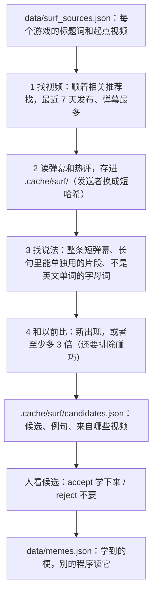

# MemeLearnerBot 设计说明

这份文档说明梗机器人是怎么设计的：有哪些部分、一次运行经过哪些步骤、别的程序怎么用它学到的梗。代码里的注释讲细节，这里讲整体。

机器人原来在翻译器（[StupidTransilator](https://github.com/HHCreator/StupidTransilator)）里（PR #8 和 PR #9），2026 年 11 月搬到这个仓库，单独开发：翻译器和别的程序只通过下面第 4 节的入口用它，不再改同一个仓库、来回合并分支。

## 1. 文件结构

```
MemeLearnerBot/
├── surf.py            根目录的入口：py surf.py，等于 py -m memelearner learn
├── pyproject.toml     pip 安装配置，定义 memelearner 命令
├── tests/             离线测试：py -m unittest（不上网）
├── docs/DESIGN.md     这份文档
├── .github/workflows/tests.yml   每次推送和 PR 在 Windows 和 Linux 上跑测试
└── memelearner/       真正的代码（一个 Python 包）
    ├── __init__.py    门面：memes()、lookup()、find()、candidates()、learn()、accept()、reject()，别的程序只调用它
    ├── __main__.py    py -m memelearner
    ├── cli.py         命令行：learn、candidates、accept、reject、forget、memes、lookup、find
    ├── surf.py        梗机器人：找 B 站上新出现或变多的说法
    ├── bilibili.py    读 B 站：搜视频、相关推荐、弹幕和热评（只读）
    ├── store.py       学到的梗和不要的说法，存在 data/memes.json
    ├── data/          梗、每个游戏的起点视频、日常说法、英文常用词
    └── .cache/surf/   读到的弹幕和评论、candidates.json（不进 git）
```

## 2. 一次运行（`surf.py` 和 `bilibili.py`）

目标是自己去 B 站找最新的梗，列出来给人看。机器人找的是「新出现或突然变多」的说法（候选），由人决定哪些是梗：`accept` 学下来，`reject` 以后不再列。



- **只读。** 像没登录的游客一样看：不发弹幕、不评论、不点赞，每两次请求之间等 5 到 7 秒（在 Hao 的电脑上，不到一分钟 28 个请求就被 B 站拦了一个小时，HTTP 412）。被 B 站风控拦住（-412、-352）就等 30 秒、60 秒再试，还不行就停下，用已经读到的东西接着分析。要验证码（返回 v_voucher）就直接跳过那个请求，不等也不重试：机器人从不过验证码。
- **找视频**（`find_videos()`）。B 站对游客的搜索经常要验证码，所以机器人像普通观众一样，顺着视频旁边的「相关推荐」找（`/x/web-interface/archive/related`，游客不用验证码）：每个游戏先从 `surf_sources.json` 里的起点视频（seeds）开始，再顺着找到的最新视频接着找，最多读 `EXPAND` 个相关推荐列表，标题里有这个游戏的词才算。挑最近 7 天发布、弹幕最多的读，不够就加最近 30 天的。以后每次从上次读过的最新视频接着找，所以起点视频只在开头、或者某个游戏断了的时候才需要（找不到视频时会提示）。搜索每次运行还是试一次，B 站肯回答就用。2026 年 10 月在 Hao 的电脑上试过：老分区接口（电子竞技 171）2025 年 4 月以后就不更新了，UP 主的视频列表也要验证码。
- **B 站接口。** 搜索和评论要 WBI 签名：从 `/x/web-interface/nav` 拿两个每天会换的 key，按固定顺序打乱拼成 mixin key；参数按名字排序，md5(查询串 + mixin key) 就是 `w_rid`（`bilibili.sign()`，单元测试用 B 站接口文档里的例子核对过）。还要一个 buvid3 访客 cookie（`/x/frontend/finger/spi`）。弹幕用老的 XML 接口 `/x/v1/dm/list.so`，不用签名，返回 deflate 压缩的 XML，里面每条弹幕带发送时间和发送者的哈希。
- **找说法**（`common_phrases()`、`freedom()`）。先数最近的句子里哪些片段至少有 3 句用过。按长度一层一层数：一个片段只有在它去掉第一个字、去掉最后一个字得到的两个短片段都常见时才数（短的不常见，长的不可能常见），这样内存很省。然后看片段两边的字是不是多样（信息熵）：「绷不住了」常常单独发，两边是句子边界，很自由；「不住了」左边永远是「绷」，只是别的说法的一部分，丢掉。「下饭了」「下饭吧」算「下饭」。
- **新不新**（`surprise()`）。比较最近 7 天和以前，用这个说法的人占所有发言的人的比例：至少多 3 倍才算变多，以前没人说过就是新的。几千个片段一起比，总有几个是碰巧变多的，所以还做二项检验：假如它其实一直这么常见，「以前的人这么少」的概率要小于 1 /（检查的片段数 × 100），也就是 `SURE = 2`。只有几个人用的新说法会先等一等，等用的人多了再列出来。
- **第一次运行没有「以前」可比**，所以会多读同样多的旧视频（30 到 90 天前发布的）当基准。以后每次运行，之前读到的句子慢慢变成「以前」，基准越来越大，用的人不多的新梗也能认出来。
- **已经知道的不算新闻**（`known_phrases()`）：学到的梗和 reject 过的说法（`data/memes.json`）、`data/surf_common.txt` 里的日常说法，还有别的程序已经知道的词：`learn(known=...)` 直接给，或者 `--known` / 环境变量 `MEMELEARNER_KNOWN` 指向它的词表文件（.json 的键和值都算，.txt 每行一个，文件夹就是里面的 .json 和 .txt，不进子文件夹）。在翻译器里的时候机器人直接读翻译器的词表；搬出来以后不再认识翻译器的代码，要用它的词表就 `--known G:\SBtranslator\sbtranslator\data`。2026 年 11 月 1 日用 Hao 电脑上读到的约 10 万条弹幕比过：加不加翻译器的词表，33 个候选里只差 blg 这种一两个。

## 3. 学到的梗（`store.py`、`data/memes.json`）

```
{"version": 1,
 "memes": {"绷不住了": {"meaning": "笑得忍不住了", "english": "can't keep a straight face",
                      "games": ["lol"], "added": "2026-11-01",
                      "examples": ["这下真的绷不住了"],
                      "sources": ["https://www.bilibili.com/video/BV17XxP6CE7n"]}},
 "rejected": {"下路": {"reason": "an everyday word", "date": "2026-11-01"}}}
```

- `memes`：学到的梗，键是说法。`meaning` 是中文意思，`english` 是英文解释，没人填的时候是空字符串；`games` 是在哪些游戏里看到的；`examples` 和 `sources` 是最多 3 句例句和它们来自的视频，`accept` 的时候从上一次运行的候选里拿。
- `rejected`：不要的说法（人名、队名、英雄名、日常说法），以后不再列成候选。`forget` 可以撤销 accept 或 reject。
- 说法都按机器人找到的样子写（`store.normal()`）：小写、半角，只留字母、数字和汉字，所以 `lookup("ＹＹＤＳ")` 也能找到 yyds。
- 这个文件是机器人的成果，跟代码一起进 git（读到的弹幕在 `.cache/` 里，不进 git）。Hao accept 完推送上去，用 pip 装机器人的程序升级一下就拿到新的梗，别的程序也可以直接从 GitHub 读这个文件。
- 写文件时先写临时文件再整个换掉，读的人不会读到一半；文件坏了（比如合并冲突）就报错，不会当成空的再存一遍，把梗全丢了。

## 4. 给别的程序用的入口

别的程序只依赖这三样，里面怎么改都不影响它们：

| 方式 | 给谁用 | 怎么用 |
|---|---|---|
| Python 包 | 翻译器这种 Python 程序 | `pip install git+https://github.com/HHCreator/MemeLearnerBot`，然后 `import memelearner`，用 `memes()`、`lookup()`、`find()`、`candidates()`、`learn()`、`accept()`、`reject()`、`forget()` |
| 命令行 | 别的语言写的程序 | `py -m memelearner memes --json`、`lookup 绷不住了 --json`、`find "文字" --json`、`candidates --json`：输出 UTF-8 的 JSON，跟 Python 函数返回的一样；`lookup` 找不到时退出码是 1 |
| 文件 | 不想调用代码的程序 | 直接读 `memelearner/data/memes.json`（格式见第 3 节），也可以从 GitHub 读：`https://raw.githubusercontent.com/HHCreator/MemeLearnerBot/main/memelearner/data/memes.json` |

- `find(text)` 找一句话里学到的梗，按出现的顺序，每个只给一次；重叠的时候长的优先（「这下真的绷不住了」里是「绷不住了」，不是「不住」）；字母组成的梗要是一个完整的词（「zywoo yyds」里有 yyds，「yydsx」里没有）。
- `learn()` 要读 B 站，所以要几分钟（每个视频大约半分钟，四个游戏全读大约 20 分钟）；B 站拒绝或者连不上只会停止读，不会让调用失败。`quiet=True` 不打印进度。
- 版本：`memelearner.API_VERSION` 和文件里的 `version` 只在某个字段改了意思或者去掉的时候才变；加新字段不变，所以用的程序要忽略不认识的字段。

## 5. 数据文件

| 文件 | 内容 | 谁读写 |
|---|---|---|
| `data/memes.json` | 学到的梗和不要的说法（第 3 节） | store.py 读写，进 git |
| `data/surf_sources.json` | 每个游戏的标题词（words）和起点视频（seeds） | 你写，surf.py 读 |
| `data/surf_common.txt` | 永远不列的日常说法（哈哈哈、加油、比赛） | 你写，surf.py 读 |
| `data/words/common_english.txt` | 1 万个常用英文单词，用来分开英文单词（nice）和字母梗（yyds） | surf.py 读 |
| `.cache/surf/` | 读到的弹幕和评论（每个视频一个 `.jsonl`，发送者是短哈希）、`videos.json`、`candidates.json` | surf.py 读写，不进 git；环境变量 `MEMELEARNER_HOME` 可以换地方，exe 里放在 `%LOCALAPPDATA%\MemeLearnerBot` |

## 6. 为什么这样设计

- **单独一个仓库。** 机器人和翻译器各改各的，不用每次都合并对方的分支。翻译器要什么只走第 4 节的入口。
- **门面。** 别的程序只依赖 `memelearner` 包最上面那几个函数、命令行的 `--json` 输出和 `memes.json` 的格式；`surf.py`、`bilibili.py` 里面怎么改都没关系。
- **人来决定什么是梗。** 机器人只会数数：它分不清梗和队名、选手名、英雄名（金克丝）。所以它只列候选，`accept` 之后才算学到。以后加本地模型或网上查询来帮忙判断，也是在候选和 `accept` 之间加一步，不改入口。
- **学到的东西进 git，读到的不进。** 梗是成果，要分享；弹幕又多又只对分析有用，留在本地。
- **不需要装别的包。** 跟翻译器一样只用 Python 自带的库，pip 安装和打包成 exe 都简单。

## 7. 想改效果，改哪里

| 想改的 | 改哪里 |
|---|---|
| 让机器人看别的视频或别的游戏 | `data/surf_sources.json` 加标题词、起点视频链接或游戏 |
| 某个普通说法老被列出来 | 加进 `data/surf_common.txt`，或者 `py -m memelearner reject 它` |
| 机器人更敏感或更保守 | `surf.py` 开头的 `MIN_PEOPLE`、`MIN_VIDEOS`、`RISE`、`SURE` |
| 不要列别的程序已经知道的词 | `--known 词表文件或文件夹`，或环境变量 `MEMELEARNER_KNOWN` |
| 每个梗多存几句例句 | `store.py` 的 `EXAMPLES` |
